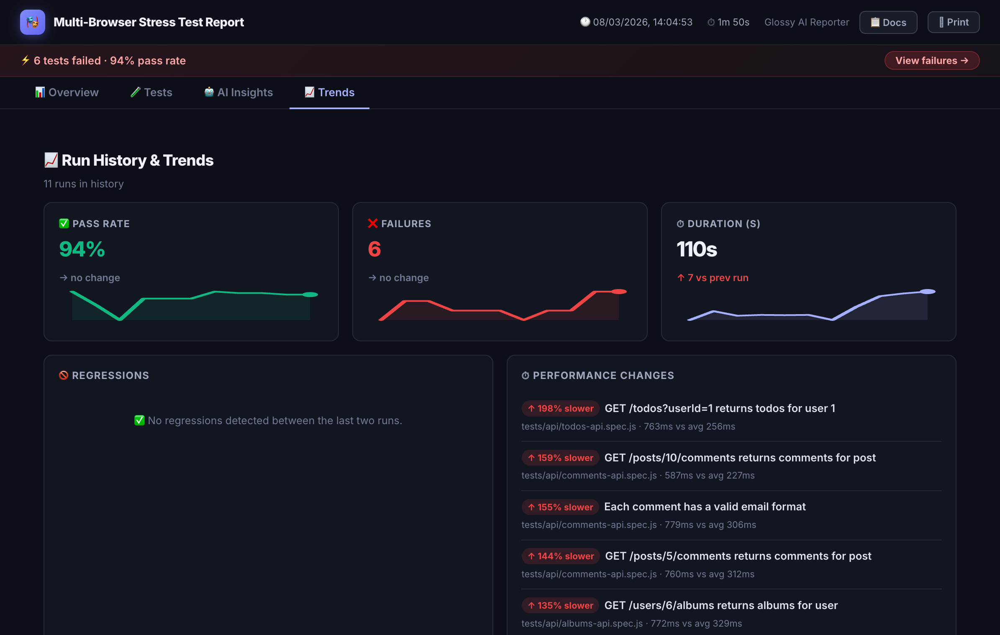

# playwright-spec-doc-reporter

A Playwright HTML reporter that reads like a specification: tests grouped as features, scenarios and behaviours, with AI root-cause analysis for every failure.

[](https://www.npmjs.com/package/playwright-spec-doc-reporter)
[](https://github.com/pnakhat/playwright-spec-doc-reporter/actions/workflows/ci.yml)
[](LICENSE)

**[▶ View a live report](https://pnakhat.github.io/playwright-spec-doc-reporter/reports/latest/)**, generated by CI from the [`js-es6-demo`](examples/js-es6-demo/) example (API tests against JSONPlaceholder + UI tests against SauceDemo) on every push to `main`. In it, look for:

- **Inline API request/response.** Open **Tests**, expand any `Posts API` / `Users API` test: each call shows its method, URL, request body, status and syntax-highlighted response JSON, next to the BDD steps.
- **UI / API filtering.** The **All · UI · API** buttons in the Tests toolbar split the run by test type (with counts) and combine with the status, tag and search filters.



## Quick start

```bash
npm install -D playwright-spec-doc-reporter
npx playwright-spec-doc-reporter init
npx playwright test
```

Open `spec-doc-report/index.html`. It is a static page, so you can upload it as a CI artifact or host it on any static site.

`init` adds the reporter to your Playwright config. To do it by hand:

```ts
// playwright.config.ts
import { defineConfig } from "@playwright/test";

export default defineConfig({
  reporter: [["list"], ["playwright-spec-doc-reporter"]],
});
```

Requires Node.js 18+ and `@playwright/test` 1.44+.

## Describe your tests

Annotations are optional. Without them, the report still shows every test, step, screenshot, video and trace. With them, it reads as documentation:

```ts
import { test, expect } from "@playwright/test";
import { addFeature, addScenario, addBehaviour } from "playwright-spec-doc-reporter/annotations";

test.beforeEach(() => addFeature("Login", "As a customer I want to sign in to see my orders"));

test("standard user can log in", async ({ page }) => {
  addScenario("Valid credentials take the user to their dashboard");

  addBehaviour("User submits valid credentials");
  await page.goto("/login");
  await page.fill("#email", "user@example.com");
  await page.click("button[type=submit]");

  addBehaviour("User lands on the dashboard");
  await expect(page).toHaveURL("/dashboard");
});
```

See [annotations](docs/annotations.md) for API request/response capture and the exportable Docs tab.

## Configuration

Every option is optional. Pass them as the second element of the reporter tuple:

```ts
reporter: [
  ["list"],
  ["playwright-spec-doc-reporter", {
    reportTitle: "Checkout E2E",
    ai: {
      enabled: true,
      provider: "anthropic",
      model: "claude-sonnet-5-5",
      apiKey: process.env.ANTHROPIC_API_KEY,
    },
  }],
],
```

The full option list is in the [configuration reference](docs/configuration.md).

## Output

| File | Contents |
|------|----------|
| `index.html` | The interactive report |
| `results.json` | Normalized results for scripts and dashboards |
| `ctrf.json` | Results in [CTRF](https://ctrf.io) format |
| `spec-doc-history.json` | Run history for trend charts (keep it between CI runs) |
| `healing.json` / `healing.md` | Suggested locator fixes (when healing is enabled) |

## Features

| Feature | What it does | Docs |
|---------|--------------|------|
| **Spec-style report** | Filter by status, type (UI / API) and tag, search, and drill into failures; BDD view; dark, dark-glossy and light themes | [Annotations](docs/annotations.md) |
| **API traffic** | Request/response JSON shown inline in each test | [Annotations](docs/annotations.md#inline-api-request--response) |
| **AI failure analysis** | Root cause and suggested fix for each failure via OpenAI, Anthropic, Azure or a custom provider | [AI analysis](docs/ai-analysis.md) |
| **CI integration** | GitHub job summary, PR comment markdown, sharded-run merging | [CI](docs/ci.md) |
| **History & flakiness** | Pass-rate and duration trends, per-test stability score | [History](docs/history.md) |
| **Healing** | Locator-fix suggestions, Playwright Healer detection, optional auto-fix PRs | [Healing](docs/healing.md) |
| **Traceability** | Maps Playwright Agent `specs/*.md` files to their tests | [Traceability](docs/traceability.md) |
| **Cucumber** | Enriches playwright-bdd tests; merges `@cucumber/cucumber` JSON reports | [Cucumber](docs/cucumber.md) |
| **Manual tests** | Merges manually executed results into the same report | [Manual tests](docs/manual-tests.md) |
| **Jira** | Posts results as issue comments; raises bugs for failures | [Jira](docs/jira.md) |
| **MCP server** | Exposes report data to AI agents such as Claude Code | [MCP](docs/mcp.md) |

## CI in one step

On GitHub Actions the reporter adds a pass/fail summary to the job page automatically. To publish the full report as well:

```yaml
- run: npx playwright test
- uses: actions/upload-artifact@v4
  if: always()
  with:
    name: spec-doc-report
    path: |
      spec-doc-report/
      test-results/
```

Screenshots, videos and traces are linked from `test-results/`, so upload both folders.

For sharded runs, PR comments and keeping history between runs, see [CI integration](docs/ci.md) and [history](docs/history.md).

## Examples

Runnable projects live in [`examples/`](examples/). Good starting points: `basic-demo` (plain Playwright), `playwright-bdd-demo` (Gherkin) and `js-es6-demo` (UI and API tests; source of the live report).

## License

[MIT](LICENSE). Built by [Pankaj Nakhat](https://www.pankajnakhat.com/).
