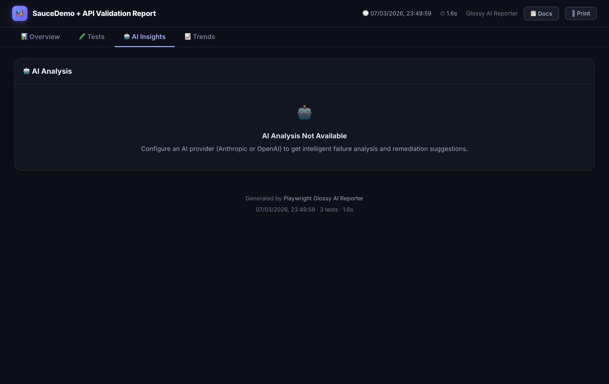

# AI failure analysis

Root-cause analysis for failed tests using OpenAI, Anthropic, Azure or your own provider.



When a test fails, the reporter automatically calls your configured AI provider to analyse the error, stack trace, and screenshot. Results appear inline next to each failing test and summarised on the **AI Insights** tab.

## OpenAI

```ts
ai: {
  enabled: true,
  provider: "openai",
  model: "gpt-4.1",              // or "gpt-4o", "gpt-4o-mini"
  apiKey: process.env.OPENAI_API_KEY,
  maxFailuresToAnalyze: 10,
  maxTokens: 1200,
  rateLimitPerMinute: 20,
}
```

## Anthropic

```ts
ai: {
  enabled: true,
  provider: "anthropic",
  model: "claude-sonnet-4-6",    // or "claude-opus-4-6", "claude-haiku-4-5"
  apiKey: process.env.ANTHROPIC_API_KEY,
  maxFailuresToAnalyze: 10,
}
```

## Azure OpenAI (OpenAI-compatible endpoint)

For Claude or other models deployed via **Azure AI Foundry / Azure AI Services** using the OpenAI-compatible chat completions endpoint:

```ts
ai: {
  enabled: true,
  provider: "azure",
  model: "claude-3-7-sonnet",          // your deployment name
  baseURL: process.env.AZURE_ENDPOINT, // https://<resource>.services.ai.azure.com
  apiKey: process.env.AZURE_API_KEY,
  apiVersion: "2024-05-01-preview",    // optional, this is the default
  maxFailuresToAnalyze: 10,
}
```

Authentication uses the `api-key` header (Azure subscription key).

## Azure Claude (native Anthropic Messages API)

For Claude models deployed via **Azure Cognitive Services** that expose the native Anthropic Messages API:

```ts
ai: {
  enabled: true,
  provider: "azure-claude",
  model: process.env.AZURE_CLAUDE_DEPLOYMENT!, // your deployment name
  baseURL: process.env.AZURE_ENDPOINT,         // https://<resource>.cognitiveservices.azure.com
  apiKey: process.env.AZURE_API_KEY,
  maxFailuresToAnalyze: 10,
}
```

The endpoint called is `{baseURL}/anthropic/v1/messages`. Authentication uses the `x-api-key` header — the same format as the standard Anthropic API.

## Custom prompt

```ts
ai: {
  enabled: true,
  provider: "anthropic",
  model: "claude-sonnet-4-6",
  apiKey: process.env.ANTHROPIC_API_KEY,
  customPrompt: `
    You are an expert in Playwright + React testing.
    Prioritise data-testid selectors over CSS classes.
    Always provide a ready-to-paste code patch when the issue is a locator.
  `,
}
```

## Custom provider

```ts
import type { AIProvider, AIProviderConfig } from "playwright-spec-doc-reporter";

const providerFactory = (_cfg: AIProviderConfig): AIProvider => ({
  name: "internal-llm",
  async analyzeFailure(input, cfg) {
    const response = await fetch("https://ai.internal/analyze", {
      method: "POST",
      headers: { Authorization: `Bearer ${cfg.apiKey}` },
      body: JSON.stringify({ error: input.errorMessage, stack: input.stackTrace }),
    });
    const data = await response.json();
    return {
      testName: input.testName,
      file: input.file,
      summary: data.summary,
      likelyRootCause: data.rootCause,
      confidence: data.confidence,
      suggestedRemediation: data.fix,
      issueCategory: data.category ?? "unknown",
      structuredFeedback: {
        actionType: data.actionType ?? "investigate",
        reasoning: data.reasoning,
        suggestedPatch: data.patch,
      },
    };
  },
});
```

Pass the factory to the reporter config:

```ts
// playwright.config.ts
import { providerFactory } from "./my-ai-provider.js";

reporter: [["playwright-spec-doc-reporter", { ai: { enabled: true }, providerFactory }]]
```

## Store the API key safely

```bash
# .env (gitignored)
ANTHROPIC_API_KEY=sk-ant-...
OPENAI_API_KEY=sk-...
AZURE_API_KEY=...
AZURE_ENDPOINT=https://<resource>.cognitiveservices.azure.com
AZURE_CLAUDE_DEPLOYMENT=claude-haiku45-gdf-np-un-001
```

Load it without dotenv (Node 20.6+):

```bash
node --env-file=.env node_modules/.bin/playwright test
```

Or add to `package.json`:

```json
{ "scripts": { "test": "node --env-file=.env node_modules/.bin/playwright test" } }
```

The `apiKey` config field falls back to provider-specific env vars automatically:

| Provider | Env var fallback |
|---|---|
| `openai` | `OPENAI_API_KEY` |
| `anthropic` | `ANTHROPIC_API_KEY` |
| `azure` | `AZURE_API_KEY` |
| `azure-claude` | `AZURE_CLAUDE_API_KEY`, then `AZURE_API_KEY` |
