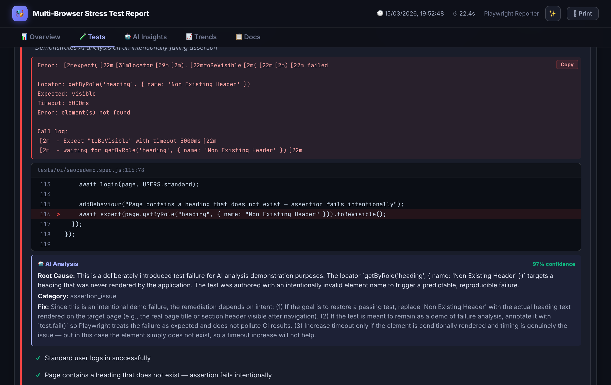

# BDD annotations, API traffic & Docs tab

Describe tests as features, scenarios and behaviours, attach API request/response pairs, and export the result as a living specification.



## BDD Annotations

Import annotation helpers from the `/annotations` sub-path and call them inside `test()` bodies.

```ts
import { addFeature, addScenario, addBehaviour } from "playwright-spec-doc-reporter/annotations";
```

### `addFeature(name, description?)`

Sets the Feature name and optional Gherkin-style narrative. Call once per `describe` block via `beforeEach`.

```ts
test.describe("Shopping Cart", () => {
  test.beforeEach(() => {
    addFeature(
      "Shopping Cart",
      "As a customer I want to add products to my cart so I can purchase them"
    );
  });

  test("add item to cart", async ({ page }) => { /* ... */ });
});
```

### `addScenario(description)`

Sets a scenario-level description (acceptance criteria) for the current test.

```ts
test("standard user can login and add item to cart", async ({ page }) => {
  addScenario("Verifies the happy-path for a standard user adding one item");
  // ...
});
```

### `addBehaviour(description)`

Adds a human-readable behaviour step. These appear in the BDD view and exported Docs instead of raw Playwright step names.

```ts
test("login flow", async ({ page }) => {
  addBehaviour("User submits valid credentials on the login page");
  await page.goto("/login");
  await page.fill("#email", "user@example.com");
  await page.click("button[type=submit]");

  addBehaviour("User is redirected to the dashboard");
  await expect(page).toHaveURL("/dashboard");
});
```


## Inline API Request / Response

Attach request and response data so they appear inline in the report with syntax-highlighted JSON.

```ts
import {
  addFeature, addScenario, addBehaviour,
  addApiRequest, addApiResponse
} from "playwright-spec-doc-reporter/annotations";

test.describe("Posts API", () => {
  test.beforeEach(() => {
    addFeature("Posts API", "As a developer I want to validate the posts endpoints");
  });

  test("POST /posts creates a resource", async ({ request, baseURL }) => {
    addScenario("Verifies a new post is created and returned with an id");

    const payload = { title: "Hello", body: "World", userId: 1 };

    addBehaviour("Client sends POST request with post data");
    addApiRequest("POST", `${baseURL}/posts`, payload);
    const res = await request.post(`${baseURL}/posts`, { data: payload });
    const body = await res.json();
    addApiResponse(res.status(), body);

    addBehaviour("Response is 201 with the new resource including an id");
    expect(res.status()).toBe(201);
    expect(body).toMatchObject(payload);
  });
});
```

The report shows each pair with a colour-coded method badge, URL, collapsible JSON body, and HTTP status badge.

**See it live:** the [sample report](https://pnakhat.github.io/playwright-spec-doc-reporter/reports/latest/) includes the `js-es6-demo` API suites (`Posts API`, `Users API`, …). Open the **Tests** tab and expand any of them.

### Filtering UI and API tests

The Tests toolbar has **All · UI · API** type buttons (with counts) when a run contains both kinds. They combine with the status, tag and search filters. A test is classified as API when any of these hold, checked in order:

1. It has an `@api` tag (or `@ui` for UI)
2. Its Playwright project name contains `api`
3. Its file path contains `/api/`
4. Its title starts with `api:` or contains `api `

The simplest setup is a dedicated `api` project, as in [`examples/js-es6-demo/playwright.config.js`](../examples/js-es6-demo/playwright.config.js). Run it **in the same `playwright test` invocation** as your UI projects (`--project=api --project=chromium`, or no `--project` flag at all). Separate invocations produce separate reports, and neither will have the type filter.

### `addApiRequest(method, url, body?, headers?)`

| Param | Type | Description |
|-------|------|-------------|
| `method` | `string` | HTTP method (`GET`, `POST`, etc.) |
| `url` | `string` | Full request URL |
| `body` | `unknown` | Request body (JSON-serialized in the report) |
| `headers` | `Record<string, string>` | Request headers (shown collapsed) |

### `addApiResponse(status, body?, headers?)`

| Param | Type | Description |
|-------|------|-------------|
| `status` | `number` | HTTP status code |
| `body` | `unknown` | Response body (JSON-serialized in the report) |
| `headers` | `Record<string, string>` | Response headers (shown collapsed) |


## Docs Page

The **Docs** tab generates a filtered behaviour specification from your annotated tests.

- **Status filter** — show All / Passed / Failed scenarios only
- **Features dropdown** — multi-select individual features; deselecting all shows an empty doc
- Filters apply immediately with no Generate button
- Export as **Markdown**, rendered **HTML**, or **PDF**
- Copy to clipboard with one click

### Theme

The report supports three themes toggled via the button in the top-right corner:

| Theme | Description |
|-------|-------------|
| `dark-glossy` | Default — dark background with glossy glass-morphism accents |
| `dark` | Standard dark mode, no blur effects |
| `light` | Light background for print or stakeholder sharing |

The selected theme is persisted in `localStorage`. Set a default via config:

```ts
// playwright.config.ts
["playwright-spec-doc-reporter", { theme: "light" }]
```
