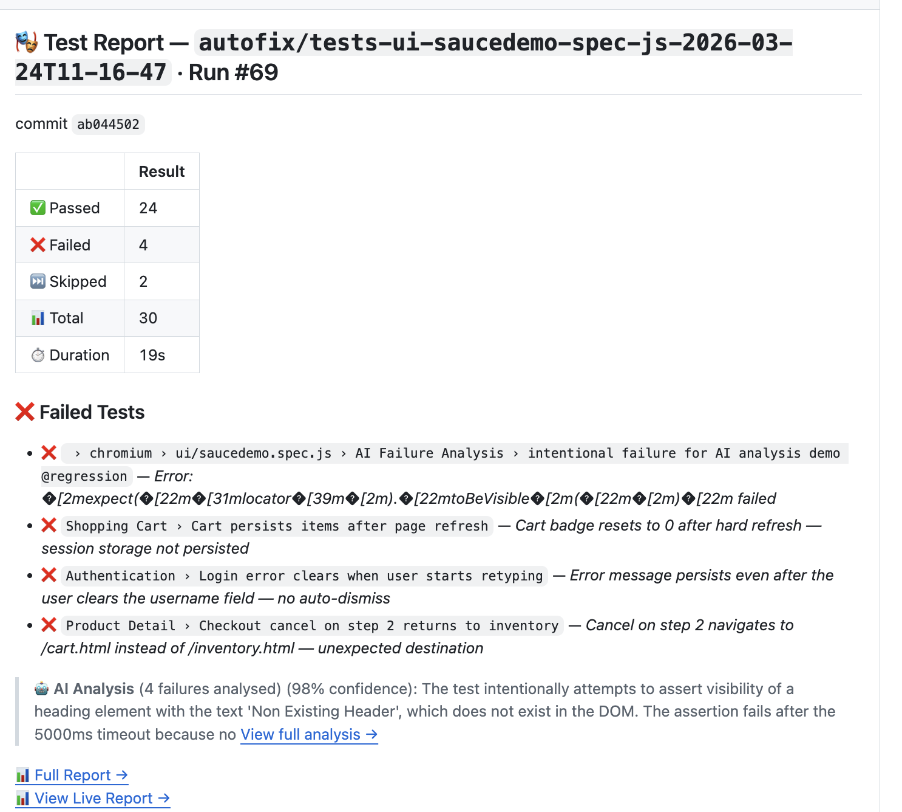

# CI integration

Job summaries, PR comments, sharded runs and CTRF output.



## CI: job summary, sharding, CTRF

**GitHub Actions job summary** — when `GITHUB_STEP_SUMMARY` is set, the pass/fail table and failed tests are appended to the job summary automatically. Disable with `githubSummary: false`.

**Sharded runs** — shard with Playwright's blob reporter, then merge into one spec-doc report:

```yaml
# each shard job
- run: npx playwright test --shard=${{ matrix.shard }}/${{ strategy.job-total }} --reporter=blob
- uses: actions/upload-artifact@v4
  with: { name: blob-${{ matrix.shard }}, path: blob-report }

# merge job (after downloading all blob-* artifacts into all-blob-reports/)
- run: npx playwright merge-reports --reporter=playwright-spec-doc-reporter ./all-blob-reports
```

Attachments (screenshots, videos) are referenced from `all-blob-reports/resources/`, so publish that folder alongside `spec-doc-report/`.

**CTRF** — `spec-doc-report/ctrf.json` follows the [Common Test Report Format](https://ctrf.io), so CTRF tools (PR comments, Slack, dashboards) can read it directly.


## PR Comment Mode

Instead of downloading a report artifact, engineers reviewing a PR get test results inline — right where they're already looking.

Enable it in `playwright.config`:

```ts
prComment: {
  enabled: true,
  artifactUrl: process.env.REPORT_ARTIFACT_URL,  // link to the uploaded HTML report
  maxFailures: 10,
}
```

This writes `spec-doc-report/pr-comment.md` after each run and posts it directly into the pull request — engineers see test results without leaving GitHub or Azure DevOps:


The comment includes:
- Pass / fail / skip counts and total duration
- Every failed test with its error message
- AI analysis summary with confidence score
- Direct links to the full HTML report and live report

### Posting the comment on GitHub

```yaml
- name: Upload report
  if: always()
  uses: actions/upload-artifact@v4
  with:
    name: test-report
    path: spec-doc-report/

- name: Post PR comment
  if: always() && github.event_name == 'pull_request'
  uses: marocchino/sticky-pull-request-comment@v2
  with:
    path: spec-doc-report/pr-comment.md
```

Set `REPORT_ARTIFACT_URL` to point reviewers at the full report:

```yaml
- name: Run tests
  run: npx playwright test
  env:
    REPORT_ARTIFACT_URL: https://github.com/${{ github.repository }}/actions/runs/${{ github.run_id }}
```

### Posting on Azure DevOps

```yaml
- task: PowerShell@2
  displayName: Post PR comment
  condition: always()
  inputs:
    targetType: inline
    script: |
      $comment = Get-Content spec-doc-report/pr-comment.md -Raw
      $body = @{ content = $comment; parentCommentId = 0; commentType = 1 } | ConvertTo-Json
      $url = "$env:SYSTEM_TEAMFOUNDATIONCOLLECTIONURI$env:SYSTEM_TEAMPROJECTID/_apis/git/repositories/$(Build.Repository.ID)/pullRequests/$(System.PullRequest.PullRequestId)/threads?api-version=7.1"
      Invoke-RestMethod -Uri $url -Method Post -Headers @{ Authorization = "Bearer $env:SYSTEM_ACCESSTOKEN" } -Body $body -ContentType "application/json"
  env:
    SYSTEM_ACCESSTOKEN: $(System.AccessToken)
```

### Branch and run detection

Branch name, commit SHA, and run number are automatically detected from CI environment variables (`GITHUB_REF_NAME`, `GITHUB_SHA`, `GITHUB_RUN_NUMBER`, and Azure DevOps equivalents). No manual configuration needed in most setups.
