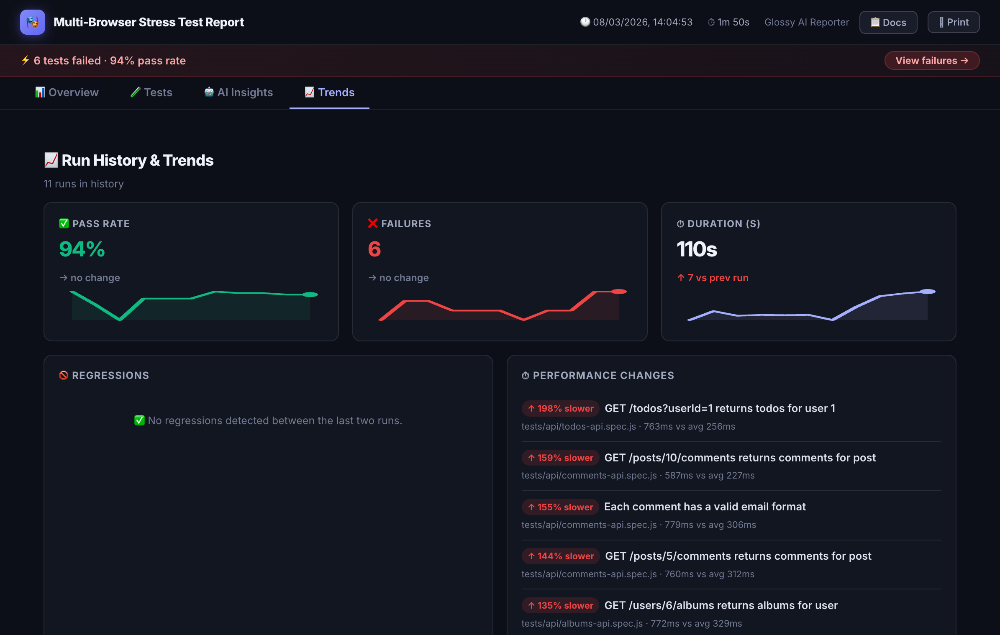

# History, trends & flakiness

Keep `spec-doc-history.json` between CI runs to get pass-rate trends and per-test stability scores.



## History & Trends

Every run, the reporter automatically:

1. Reads `spec-doc-history.json` from the output directory (starts fresh if none exists)
2. Computes per-test **flakiness scores** from prior history
3. Appends a `RunSnapshot` — pass rate, per-test statuses, branch name, commit SHA
4. Saves the updated history file
5. Embeds the full history into `index.html` for the **Trends** tab

History is capped at **30 runs** (oldest entries dropped automatically).

The Trends tab shows:
- Pass rate / failure count / duration charts over time
- **Root-cause trends** — when AI analysis (`ai.enabled: true`) is on, each failure's diagnosed category (`locator_drift`, `timing_issue`, `environment_issue`, `test_data_issue`, `assertion_issue`, `app_bug`, `unknown`) is persisted into history, so you can see whether failures are trending toward brittle locators or real app bugs
- Regressions (tests that newly failed vs previous run)
- Performance changes (tests that got significantly slower or faster)
- Full run history table with branch and commit info

### Persisting history in CI/CD

By default each CI run gets a clean workspace, so `spec-doc-history.json` is lost between runs and trends won't accumulate. Choose one of the following strategies to persist it.

#### Option 1 — GitHub Actions cache (recommended)

```yaml
jobs:
  test:
    runs-on: ubuntu-latest
    steps:
      - uses: actions/checkout@v4

      - name: Restore test history
        uses: actions/cache@v4
        with:
          path: spec-doc-report/spec-doc-history.json
          key: test-history-${{ github.ref }}-${{ github.run_id }}
          restore-keys: |
            test-history-${{ github.ref }}-
            test-history-

      - name: Install dependencies
        run: npm ci

      - name: Run tests
        run: npx playwright test

      - name: Upload report artifact
        if: always()
        uses: actions/upload-artifact@v4
        with:
          name: test-report
          path: spec-doc-report/
```

The `restore-keys` fallback means a new branch inherits the most recent history from any branch, so trends start immediately rather than from scratch.

#### Option 2 — Commit history file to git

```yaml
      - name: Run tests
        run: npx playwright test

      - name: Commit updated history
        run: |
          git config user.email "ci@example.com"
          git config user.name "CI Bot"
          git add spec-doc-report/spec-doc-history.json
          git commit -m "chore: update test history [skip ci]" || exit 0
          git push
```

Use `[skip ci]` in the commit message to prevent a recursive pipeline trigger.

#### Option 3 — Upload/download as artifact

```yaml
      - name: Download previous history
        uses: actions/download-artifact@v4
        with:
          name: test-history
          path: spec-doc-report/
        continue-on-error: true   # first run won't have it yet

      - name: Run tests
        run: npx playwright test

      - name: Upload updated history
        if: always()
        uses: actions/upload-artifact@v4
        with:
          name: test-history
          path: spec-doc-report/spec-doc-history.json
          retention-days: 90
          overwrite: true
```

---

### Persisting history in Azure Pipelines

The same three strategies apply in Azure Pipelines using its equivalent primitives.

#### Option 1 — Pipeline cache (recommended)

```yaml
variables:
  HISTORY_KEY: test-history-$(Build.SourceBranchName)

steps:
  - task: Cache@2
    displayName: Restore test history
    inputs:
      key: '"spec-doc-history" | "$(Build.SourceBranchName)" | "$(Build.BuildId)"'
      restoreKeys: |
        "spec-doc-history" | "$(Build.SourceBranchName)"
        "spec-doc-history"
      path: spec-doc-report/spec-doc-history.json
      cacheHitVar: HISTORY_CACHE_HIT

  - script: npx playwright test
    displayName: Run tests

  - task: PublishPipelineArtifact@1
    condition: always()
    displayName: Upload report
    inputs:
      targetPath: spec-doc-report
      artifact: test-report
```

The `restoreKeys` fallback ensures a new branch inherits the closest available history.

#### Option 2 — Commit history file to git

```yaml
  - script: npx playwright test
    displayName: Run tests

  - script: |
      git config user.email "ci@example.com"
      git config user.name "CI Bot"
      git add spec-doc-report/spec-doc-history.json
      git diff --cached --quiet || git commit -m "chore: update test history ***NO_CI***"
      git push origin HEAD:$(Build.SourceBranchName)
    displayName: Commit updated history
```

Use `***NO_CI***` (or `[skip ci]`) in the commit message to prevent a recursive pipeline trigger.

#### Option 3 — Upload/download as artifact

```yaml
  - task: DownloadPipelineArtifact@2
    displayName: Download previous history
    condition: always()
    continueOnError: true   # first run won't have it yet
    inputs:
      artifact: test-history
      targetPath: spec-doc-report

  - script: npx playwright test
    displayName: Run tests

  - task: PublishPipelineArtifact@1
    condition: always()
    displayName: Upload updated history
    inputs:
      targetPath: spec-doc-report/spec-doc-history.json
      artifact: test-history
```

> **Note:** Azure Pipelines artifacts are immutable per run — you cannot overwrite a published artifact in the same pipeline run. Use the Cache task (Option 1) if you need the history to persist across runs on the same branch without manual cleanup.


## Flakiness Scoring

The reporter computes a **flakiness score (0–100%)** per test from the last 10 runs in history:

- Score = (number of pass↔fail transitions) / (runs − 1) × 100
- Skipped runs are excluded from the calculation
- Scores appear as inline badges on test rows: `⚡ 67%`
- Colour coded: **low** (1–29%), **medium** (30–69%), **high** (≥70%)
- A summary card on the Overview page lists the most flaky tests

Flakiness requires at least **2 prior runs** in history. No history = no badges.
